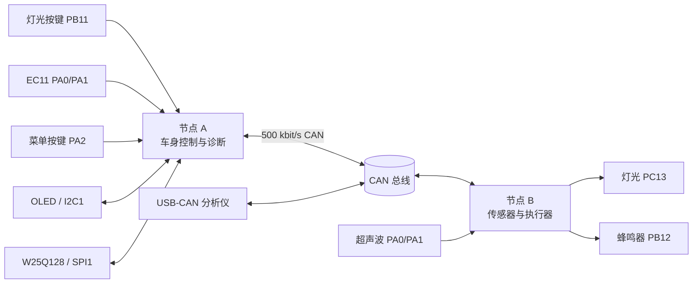

# Body-Control-CAN-Network

一个基于两块 STM32F103 的车身控制网络教学项目。系统通过经典 CAN 总线连接控制节点与执行节点，完成灯光控制、超声波泊车提示、非阻塞蜂鸣器、OLED 诊断界面、事件日志、DTC 状态管理、冻结帧、掉电保存、看门狗与 CAN 故障恢复。

当前版本：**V0.9 收尾版**。本版本不新增通信协议和硬件功能，重点完成工程说明、接口约定、测试清单和演示材料。

## 系统组成



- **节点 A：Body Control / Diagnostic Node**
  使用 STM32CubeMX + HAL。负责灯光命令、状态同步、OLED 菜单、EC11 输入、DTC、冻结帧、事件日志以及 W25Q128 持久化。
- **节点 B：Actuator / Sensor Node**
  使用 STM32 标准外设库。负责灯光执行、超声波测距、五点中值滤波、泊车蜂鸣器、健康状态、看门狗和 CAN 恢复。
- **外部测试端**
  USB-CAN 工具用于监听周期报文、查询日志和 DTC，以及执行受保护的清除操作。

## 主要能力

- 500 kbit/s、11 位标准帧 CAN 通信
- 命令序号、状态回传、掉线检测与重新同步
- 超声波非阻塞测距与五点中值滤波
- 四级泊车提示：静音、慢鸣、快鸣、连续鸣叫
- CAN warning / passive / bus-off 诊断与自动恢复
- 独立看门狗复位识别与历史故障记录
- DTC 激活、确认、恢复、历史和清除状态管理
- W25Q128 事件日志、DTC 快照与冻结帧
- OLED 五页面诊断界面，EC11 旋转和按键操作
- 所有周期任务均不依赖 `HAL_Delay()` 阻塞主循环

## 硬件清单

- STM32F103C8T6 最小系统板 × 2
- CAN 收发器模块 × 2
- CAN 分析仪 × 1
- SSD1306 兼容 128×64 OLED × 1
- W25Q128 SPI Flash × 1
- EC11 旋转编码器模块 × 1
- 超声波测距模块 × 1
- 有源蜂鸣器、按键及必要的限流/电平转换器件
- CAN 总线两端各 120 Ω 终端电阻

完整接线见 [硬件与接线](docs/hardware.md)。

## 快速开始

1. 按 [硬件与接线](docs/hardware.md) 连接两节点，确保共地，并只在总线两端接入 120 Ω 终端电阻。
2. 将 CAN 分析仪设置为标准帧、500 kbit/s；当前工程采样点约为 77.8%。
3. 分别编译并下载两个工程：
   - 节点 A：`Body-Control-Simulator-Project/MDK-ARM/Body Control Simulator Project.uvprojx`
   - 节点 B：`Body-Control-Actuator-Node/Body-Control-Actuator-Node.uvprojx`
4. 上电后检查 `0x101`、`0x111`、`0x114` 周期报文，再操作灯光按键、旋转编码器和超声波目标物。
5. 按 [回归测试](docs/testing.md) 完成发布前检查。

节点 A 的 CubeMX 配置保存在 `.ioc` 文件中。若重新生成代码，应保留所有 `USER CODE` 区域，并重新编译两个节点。

## CAN 报文概览

| ID | 方向 | 名称 | 周期/触发 |
|---|---|---|---|
| `0x100` | A → B | 灯光控制 | 状态变化/重发 |
| `0x101` | B → A | 心跳 | 约 1 s |
| `0x102` | B → A | 灯光状态 | 状态变化/应答 |
| `0x103` | 测试端 → A | 事件日志查询/清除 | 请求 |
| `0x104` | A → 测试端 | 日志摘要 | 应答 |
| `0x105` | A → 测试端 | 日志序号与时间 | 应答 |
| `0x111` | B → A | 泊车距离 | 约 100 ms |
| `0x114` | B → A | 健康状态 | 约 1 s |
| `0x115` | 测试端 → A | DTC 查询/清除 | 请求 |
| `0x116` | A → 测试端 | DTC 摘要/明细 | 应答 |
| `0x117` | A → 测试端 | 冻结帧数据 | 明细应答 |
| `0x118` | A → 测试端 | 冻结帧时间 | 明细应答 |

逐字节定义和测试示例见 [CAN 协议](docs/can-protocol.md)。

## 文档导航

- [系统架构](docs/architecture.md)
- [硬件与接线](docs/hardware.md)
- [CAN 协议](docs/can-protocol.md)
- [回归测试](docs/testing.md)
- [演示与面试说明](docs/interview-guide.md)
- [V0.9 版本说明](Body-Control-CAN-Network%20V0.9.md)
- [V0.8 版本说明](Body-Control-CAN-Network%20V0.8.md)
- [V0.7 版本说明](Body-Control-CAN-Network%20V0.7.md)

## 目录结构

```text
Body-Control-CAN-Network/
├─ Body-Control-Simulator-Project/   节点 A：控制、显示、诊断与存储
├─ Body-Control-Actuator-Node/       节点 B：测距、灯光、蜂鸣器与健康监控
├─ docs/                             架构、接线、协议、测试与演示文档
├─ Body-Control-CAN-Network V0.x.md  各版本开发与验收记录
└─ README.md                         项目入口
```

## 项目定位

本项目用于嵌入式与车载网络学习、作品展示和面试演示。它体现了双节点通信、非阻塞任务、故障诊断和持久化设计，但不等同于通过功能安全、EMC、环境可靠性或量产验证的汽车 ECU。
