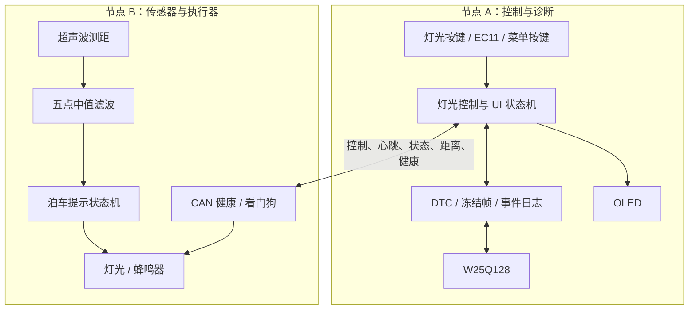
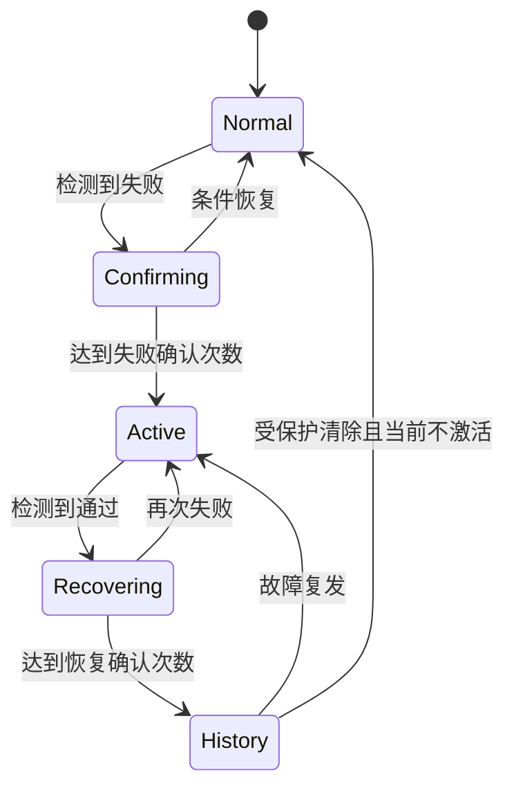

# 系统架构

## 1. 设计目标

项目把车身控制功能拆分为两个独立节点，通过 CAN 完成控制、反馈、健康监测与诊断。设计重点不是功能数量，而是让多个周期任务在无操作系统环境下稳定并发，并在断线、总线异常或复位后恢复到一致状态。

## 2. 节点职责

节点 A 使用 STM32CubeMX/HAL 管理时钟、GPIO、CAN、I2C、SPI 和 TIM2 编码器。节点 B 保留标准外设库实现，以展示两种常见 STM32 工程组织方式。

## 3. 非阻塞调度

两个节点都采用“短任务 + 时间戳”方式运行：每次主循环只检查是否到期并推进一个状态，不在业务路径中等待硬件完成。

这种结构保证超声波等待回波、蜂鸣器节拍、OLED 刷新和 Flash 操作不会用 `HAL_Delay()` 长时间占用主循环。

## 4. 控制闭环与重新同步

1. 节点 A 改变目标灯光状态并增加命令序号，通过 `0x100` 发送。
2. 节点 B 执行命令，通过 `0x102` 回传实际状态和所处理的序号。
3. 节点 A 根据序号确认应答，超时则记录事件并按策略重发。
4. 节点 B 在 `0x101` 中报告 `needs_sync`；上电或重新上线后，节点 A 重新下发当前目标状态。

该流程避免节点复位后仅凭旧变量猜测灯光状态。

## 5. DTC 状态管理

- `active` 表示当前故障仍满足判定条件。
- `stored/history` 表示故障曾被确认；即使恢复也会保留，直到清除成功。
- 首次确认故障时保存冻结帧，包含节点 B 健康标志、CAN LEC、复位原因、距离和时间。
- 活跃故障不可被清除，清除请求返回状态码 `0x03`。

| DTC | 含义 | 激活确认 | 恢复确认 |
|---|---|---:|---:|
| `01` | 超声波无效 | 3 次失败 | 3 次通过 |
| `02` | 节点 B 离线 | 3 s 超时 | 2 个心跳 |
| `03` | CAN warning | 2 次失败 | 3 次通过 |
| `04` | CAN passive | 2 次失败 | 3 次通过 |
| `05` | CAN bus-off | 立即 | 3 次通过 |
| `06` | 节点 B 看门狗复位历史 | 1 次异常复位 | 仅保存历史 |

## 6. 泊车提示状态机

距离先经过五点中值滤波，再进入带迟滞的区间判断：

| 距离 | 蜂鸣器模式 |
|---|---|
| `< 200 mm` | 连续鸣叫 |
| `200–499 mm` | 每 100 ms 翻转，快速鸣叫 |
| `500–999 mm` | 每 400 ms 翻转，慢速鸣叫 |
| `≥ 1000 mm` 或测距无效 | 静音 |

释放阈值使用 230、530、1050 mm，减少目标位于边界时的模式抖动。灯光操作还会触发一次 100 ms 的确认提示，但不会阻塞测距与 CAN。

## 7. Flash 数据布局

W25Q128 尾部三个 4 KiB 扇区用于持久化：

| 地址范围 | 用途 |
|---|---|
| `0x00FFD000–0x00FFDFFF` | DTC 快照 |
| `0x00FFE000–0x00FFEFFF` | 事件日志 |
| `0x00FFF000–0x00FFFFFF` | Flash 自检 |

事件日志按序写入，DTC 快照保存当前/历史状态及冻结帧。自检使用独立扇区，避免破坏正式数据。

## 8. 故障恢复原则

- CAN 自动 bus-off 管理在 CubeMX 中启用；软件同时观测 warning、passive、bus-off 和 LEC。
- 看门狗在关键外设和应用状态初始化完成后启动，避免启动阶段发生无意义复位循环。
- 喂狗取决于主循环关键任务持续推进，而不是无条件刷新。
- 节点离线时保持本地安全行为；通信恢复后通过心跳、序号和状态反馈重新建立一致性。
